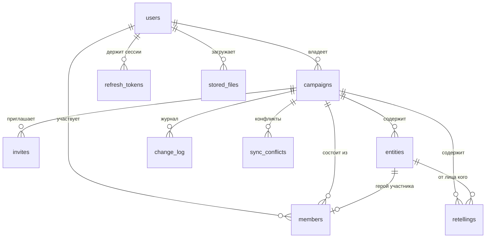

# Модель данных

Схема создаётся миграцией
[`server/src/main/resources/db/migration/V1__init.sql`](../server/src/main/resources/db/migration/V1__init.sql).
Сверка маппинга JPA с SQL — `node scripts/check-schema.mjs`.

## Таблицы

### `users`
Пользователь. `provider` = `LOCAL` (почта+пароль) или `YANDEX`/`VK`.
Пара `(provider, provider_user_id)` уникальна; `password_hash` пустой у тех, кто
входит только через внешнего провайдера.

### `refresh_tokens`
Хранится **SHA-256 хеш** refresh-токена, сам токен нигде не сохраняется. При каждом
обновлении старый токен помечается `revoked`, выдаётся новый (ротация).

### `campaigns`
Кампания (сессия). Ключевое поле — `revision`: монотонный счётчик изменений,
точка отсчёта синхронизации. `deleted` — мягкое удаление, чтобы клиенты узнали об
удалении через журнал.

### `members`
Участник кампании: `role` (`OWNER`, `EDITOR_MASTER`, `EDITOR_HERO`, `VIEWER`),
необязательная связь с героем `linked_entity_id`, состояние `status`
(`ACTIVE`, `INVITED`, `REMOVED`). Уникально по `(campaign_id, user_id)` — повторное
приглашение не создаёт вторую строку, а переиспользует её.

### `invites`
Приглашение: короткий `token` (8 символов `A–Z0–9`), роль и связь с героем, срок
жизни, лимит использований. Из `token` собираются ссылка и QR-код.

### `entities`
**Все объекты справочника в одной таблице**: герои, персонажи, локации, предметы.
Различия — в `type` и JSON-колонке `attrs`:

| Тип | Поля `attrs` |
|---|---|
| `HERO` | `playerName`, `race`, `klass`, `level`, `hp`, `ac`, `status` |
| `NPC` | `faction`, `status`, `locationEntityId` |
| `LOCATION` | `region`, `kind`, `parentEntityId` |
| `ITEM` | `kind`, `ownerEntityId`, `locationEntityId`, `quantity`, `rarity` |

* `client_id` уникален в пределах кампании — защита от дублей при офлайн-создании
  на двух устройствах.
* `revision` — ревизия кампании, на которой объект в последний раз менялся.
* Ссылки `[[Имя]]` в `summary` и `description` **не хранятся отдельно**: они
  разбираются на лету (`WikiLinkService`) и попадают в ответ `links`. Так текст
  остаётся самодостаточным, а переименование объекта не рвёт ссылки.

### `retellings`
Пересказы. `status` на сервере всегда `PUBLISHED`: черновик (`DRAFT`) живёт только на
устройстве и на сервер не отправляется. `author_entity_id` — от лица кого написан
пересказ.

### `change_log`
Журнал изменений — основа синхронизации. На каждое изменение: `revision`, тип объекта,
`op` (`UPSERT`/`DELETE`), полное состояние объекта в `payload`, автор, `client_change_id`
и `device_id`. Уникальность `(campaign_id, revision)` гарантирует отсутствие дыр и
дублей, уникальность `(campaign_id, client_change_id)` — идемпотентность повторной
отправки. Записи компактизуются по возрасту и количеству (`MaintenanceJob`).

### `sync_conflicts`
Зафиксированные расхождения: причина (`stale_base`, `forbidden`, `client_wins`,
`draft_not_synced`, `unsupported_type`), состояние сервера и версия клиента.
Нужна для разбора «почему моя правка не применилась».

### `stored_files`
Метаданные загруженных файлов. Сами файлы — на диске (`DND_FILES_DIR`, в Docker
отдельный том), в базе только путь и тип.

## Почему так

* **Одна таблица на все типы объектов.** Ссылки, поиск, вкладки и синхронизация
  получаются одинаковыми; добавление нового типа (например, «фракции») — это новое
  значение `type` и набор полей в `attrs`, без миграции схемы.
* **Журнал вместо `updated_at`-сканов.** Клиент помнит одно число
  (`lastPulledRevision`) и получает ровно то, что изменилось.
* **Мягкое удаление.** Надгробие в журнале нужно, чтобы офлайн-клиент узнал об
  удалении, а не «воскресил» запись при следующей синхронизации.
* **`jsonb` + `stringtype=unspecified`.** Документы `attrs` и `payload` пишутся из
  строк без приведения типов; параметр в строке подключения обязателен.
