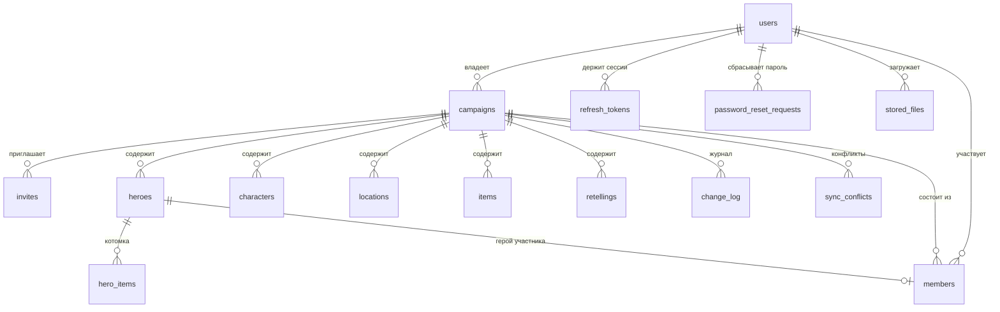

# Модель данных

Схема создаётся миграциями
[`V1__init.sql`](../server/src/main/resources/db/migration/V1__init.sql),
[`V2__devices_and_contacts.sql`](../server/src/main/resources/db/migration/V2__devices_and_contacts.sql)
и [`V3__classes_and_login.sql`](../server/src/main/resources/db/migration/V3__classes_and_login.sql)
(переработка v2 — [`redesign-v2.md`](redesign-v2.md)).
Сверка маппинга JPA с SQL — `node scripts/check-schema.mjs`.

## Таблицы

### `users`
Пользователь. Вход — только по логину и паролю: `login` (уникальный, 3–32 символа
`a–z0–9_.-`, хранится в нижнем регистре), `email` (обязателен и уникален),
`password_hash` (BCrypt), `email_verified` (пока всегда `false` — SMTP не настроен),
необязательный уникальный `phone` в формате `+7XXXXXXXXXX`. Внешних провайдеров
входа (`provider`, `provider_user_id`) больше нет.

### `refresh_tokens`
Хранится **SHA-256 хеш** refresh-токена, сам токен нигде не сохраняется. При каждом
обновлении старый токен помечается `revoked`, выдаётся новый (ротация). `platform`
(`web`/`android`) задаёт срок жизни новой сессии: 30 дней или 365 дней.

### `password_reset_requests`
Ожидающие сбросы пароля. Хранится только хеш токена (`token_hash`), срок жизни —
час, признак `used`. Сам токен выводится из секрета сервера, пользователя и времени
запроса (`TokenUtils.passwordResetToken`), поэтому его можно показать администратору,
не сохраняя в базе.

### `campaigns`
Кампания (сессия). Ключевое поле — `revision`: монотонный счётчик изменений,
точка отсчёта синхронизации. `deleted` — мягкое удаление, чтобы клиенты узнали об
удалении через журнал.

### `members`
Участник кампании: `role` (`OWNER`, `EDITOR_MASTER`, `EDITOR_HERO`, `VIEWER`),
необязательная привязка к герою `linked_hero_id`, состояние `status`
(`ACTIVE`, `INVITED`, `REMOVED`). Уникально по `(campaign_id, user_id)` — повторное
приглашение не создаёт вторую строку, а переиспользует её.

### `invites`
Приглашение: короткий `token` (8 символов `A–Z0–9`), роль и необязательная привязка
к герою (`linked_hero_id`), срок жизни, `max_uses` (всегда 1) и `uses`. Приглашение
строго одноразовое: принятие помечает его использованным. Из `token` собираются
ссылка и QR-код.

### `heroes`, `characters`, `locations`, `items`
Четыре класса справочника — своя таблица на каждый. Общие колонки одинаковы:
`id`, `campaign_id`, `name`, `description`, `image_file_id`, `deleted`, `created_at`,
`updated_at`, `created_by`, `updated_by`, `revision`. В коде они объявлены один раз
в цепочке `@MappedSuperclass`
(`GameEntityExtender → NamedExtender → SyncExtender → ImageExtender`), поэтому новое
поле одного класса не затрагивает остальные.

| Таблица | Свои колонки |
|---|---|
| `heroes` | `race`, `klass`, `player_user_id` |
| `characters` | `race`, `short_description` |
| `locations` | — |
| `items` | `owner_name`, `owner_hero_id`, `owner_character_id` |

* `revision` — ревизия кампании, на которой объект в последний раз менялся.
* Ссылки `[[Имя]]` в `description` **не хранятся отдельно**: они разбираются на
  лету (`WikiLinkService`) по всем четырём таблицам и попадают в ответ `links`. Так
  текст остаётся самодостаточным, а переименование объекта не рвёт ссылки.
* Ключ сопоставления при синхронизации задан методом класса: `heroes`, `locations`,
  `items` — по имени, `characters` — по имени и расе. Отдельной колонки для него нет.

### `hero_items`
Предметы в котомке героя: `id`, `hero_id`, `name`, `item_id` (ссылка на предмет
кампании, если название нашлось по имени), `quantity`, `notes`, `position`.
Список всегда едет вместе с героем.

### `retellings`
Пересказы. `status` на сервере всегда `PUBLISHED`: черновик (`DRAFT`) живёт только на
устройстве и на сервер не отправляется. `author_entity_id` — от лица кого написан
пересказ (герой или персонаж).

### `change_log`
Журнал изменений — основа синхронизации. На каждое изменение: `revision`, тип объекта
(`object_type` — `HERO`, `CHARACTER`, `LOCATION`, `ITEM`, `RETELLING`, `CAMPAIGN`,
`MEMBER`), `op` (`UPSERT`/`DELETE`), полное состояние объекта в `payload` (форма DTO
своего класса), автор, `client_change_id` и `device_id` (идентификатор установки
клиента). Уникальность `(campaign_id, revision)` гарантирует отсутствие дыр и
дублей, уникальность `(campaign_id, client_change_id)` — идемпотентность повторной
отправки. Записи компактизуются по возрасту и количеству (`MaintenanceJob`).

### `sync_conflicts`
Зафиксированные расхождения: причина (`matched_by_name`, `matched_by_name_and_race`,
`stale_base`, `client_wins`, `forbidden`, `validation_failed`, `draft_not_synced`,
`unsupported_type`), состояние сервера и версия клиента. Нужна для разбора «почему
моя правка не применилась».

### `stored_files`
Метаданные загруженных файлов. Сами файлы — на диске (`DND_FILES_DIR`, в Docker
отдельный том), в базе только путь и тип.

## Почему так

* **Своя таблица на каждый класс.** Новое поле типа не затрагивает остальные, а
  общая часть объявлена один раз в `@MappedSuperclass`; ссылки, поиск и
  синхронизация при этом остаются общими — их ведёт `AbstractObjectService` и
  сводный индекс `ObjectIndexService`.
* **Ключ сопоставления в классе.** Дубли при офлайн-создании ловятся по имени
  (у персонажа — по имени и расе); правило живёт в самом классе, поэтому меняется
  одной строкой, а не миграцией.
* **Журнал вместо `updated_at`-сканов.** Клиент помнит одно число
  (`lastPulledRevision`) и получает ровно то, что изменилось.
* **Мягкое удаление.** Надгробие в журнале нужно, чтобы офлайн-клиент узнал об
  удалении, а не «воскресил» запись при следующей синхронизации.
* **Хеши вместо токенов.** И refresh-, и reset-токены лежат в базе только хешами;
  токен сброса при этом детерминированно выводится из секрета сервера, чтобы его
  можно было показать администратору.
